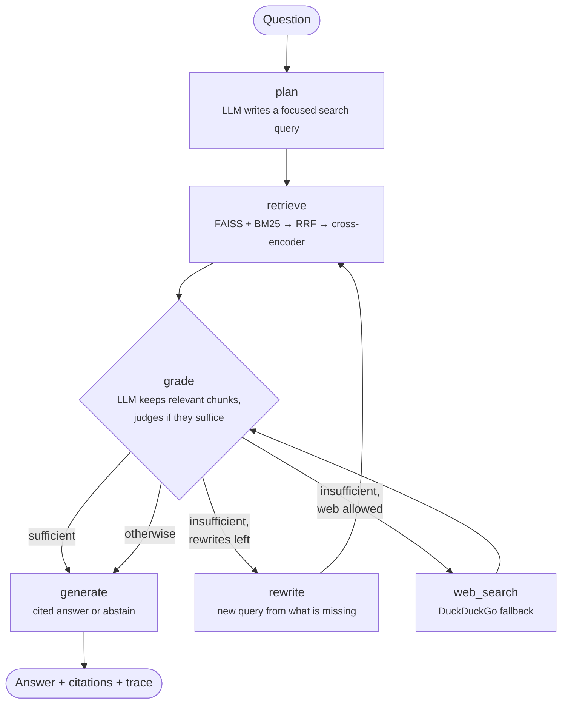

# ⚡ Jolt: Agentic RAG Research Assistant

[](https://github.com/Hmzaah/My-Agent/actions/workflows/ci.yml)


Jolt answers questions over your own documents and cites every claim. It is an **agentic**
retrieval-augmented generation (RAG) system: instead of retrieving once and hoping, a LangGraph
state machine plans a search, grades what it found, rewrites the query when the evidence is
weak, falls back to the web when the local index has nothing, and says *"I don't know"* rather
than guessing.

It is built to run fully offline on a consumer GPU (for example an RTX 3050 with a 4-bit
Qwen2.5-3B GGUF through llama.cpp) or against any OpenAI-compatible server such as Ollama.

## Features

- **Agent loop in LangGraph**: plan → retrieve → grade → (rewrite → retrieve)* → web fallback → answer, with a per-step trace returned to the caller.
- **Hybrid retrieval**: dense vectors (FAISS, `all-MiniLM-L6-v2`) and BM25 keyword search, merged with reciprocal rank fusion, then re-scored by a cross-encoder.
- **Grounded answers**: numbered citations to file and page (or URL); explicit abstention when the sources do not answer the question.
- **Pluggable models**: llama.cpp (local GGUF on GPU), or any OpenAI-compatible API (Ollama, vLLM, LM Studio, Groq, OpenAI), switched by one environment variable.
- **Serving**: FastAPI service (`/v1/ask`, `/v1/documents`, `/health`, `/v1/graph`), Typer CLI, Streamlit chat UI, Docker Compose stack with Ollama.
- **Evaluation harness**: retrieval hit@k and MRR, answer keyword recall, citation precision, abstention accuracy and p50/p95 latency on a labelled question set.
- **Engineering**: typed config (pydantic-settings), 37 tests at 93% coverage that run offline with no model downloads, ruff + mypy, GitHub Actions CI on Python 3.10–3.12.

## Architecture



The routing decision after `grade` is plain Python in [`agent/graph.py`](src/jolt/agent/graph.py);
each step is a method in [`agent/nodes.py`](src/jolt/agent/nodes.py). See
[docs/how-it-works.md](docs/how-it-works.md) for a walkthrough of every component and the design
decisions behind it.

## Quick start

```bash
git clone https://github.com/Hmzaah/My-Agent.git && cd My-Agent
python -m venv .venv && source .venv/bin/activate        # Windows: .venv\Scripts\activate
pip install -e ".[embeddings,ui]"
cp .env.example .env
```

Pick a model backend in `.env`:

**Option A: local GPU with llama.cpp**

```bash
CMAKE_ARGS="-DGGML_CUDA=on" pip install -e ".[local]"    # CUDA build of llama-cpp-python
# Download a GGUF model, e.g. Qwen2.5-3B-Instruct Q4_K_M, into models/
# and set JOLT_LLM_MODEL_PATH in .env
```

**Option B: Ollama (or any OpenAI-compatible server)**

```bash
ollama pull qwen2.5:3b
# in .env: JOLT_LLM_BACKEND=openai, JOLT_OPENAI_BASE_URL=http://localhost:11434/v1
```

Then index documents and ask:

```bash
jolt ingest data/sample                   # .pdf, .txt and .md, files or folders
jolt ask "Why does OFDM use a cyclic prefix?"
jolt serve                                # API on http://127.0.0.1:8000 (docs at /docs)
streamlit run ui/streamlit_app.py         # chat UI
```

### Docker

```bash
docker compose up -d
docker compose exec ollama ollama pull qwen2.5:3b
docker compose exec api jolt ingest data/sample
# UI: http://localhost:8501   API docs: http://localhost:8000/docs
```

## API

```bash
curl -s localhost:8000/v1/ask -H 'content-type: application/json' \
  -d '{"question": "How can sneak-path currents in RRAM crossbars be suppressed?"}'
```

```json
{
  "answer": "Adding a selector device or transistor in series with each cell suppresses sneak paths [1].",
  "citations": [{"index": 1, "source": "rram_memory.md", "page": null, "url": null, "snippet": "..."}],
  "grounded": true,
  "used_web": false,
  "rewrites": 0,
  "trace": [
    {"node": "plan", "detail": "search query: 'RRAM crossbar sneak path suppression'", "duration_ms": 410.2},
    {"node": "retrieve", "detail": "5 chunks", "duration_ms": 38.5},
    {"node": "grade", "detail": "kept 2/5, sufficient=True", "duration_ms": 690.1},
    {"node": "generate", "detail": "1 citations", "duration_ms": 1210.7}
  ],
  "latency_ms": 2351.0
}
```

*(Example of the response shape; the values are illustrative.)*

Upload documents with `POST /v1/documents` (multipart, field `files`). Interactive docs are at `/docs`.

## Evaluation

`eval/questions.jsonl` holds 22 labelled questions over the sample corpus: 18 answerable (with
the expected source file and key facts) and 4 deliberately unanswerable, to check that the agent
refuses instead of hallucinating.

```bash
jolt eval eval/questions.jsonl --no-web
```

This writes a Markdown and JSON report to `eval/results/`. Metrics:

| Metric | What it measures |
|---|---|
| Retrieval hit@k | an expected source is among the top-k chunks |
| Retrieval MRR | 1 / rank of the first correct chunk, averaged |
| Answer rate | answerable questions that were not refused |
| Abstention accuracy | unanswerable questions that were refused |
| Keyword recall | expected facts that appear in the answer |
| Citation precision | citations that point at a correct source |
| Latency p50 / p95 | end-to-end time per question |

### Results

<!-- Paste the table printed by `jolt eval` here, with the hardware and model you used. -->
_Run `jolt eval` with your model and paste the results here._

## Configuration

All settings live in [`src/jolt/config.py`](src/jolt/config.py) and can be set as environment
variables with the `JOLT_` prefix or in `.env`. The most useful ones:

| Variable | Default | Purpose |
|---|---|---|
| `JOLT_LLM_BACKEND` | `llamacpp` | `llamacpp`, `openai` (any compatible server) or `fake` (offline tests) |
| `JOLT_LLM_MODEL_PATH` | `models/qwen2.5-3b-instruct-q4_k_m.gguf` | GGUF file for llama.cpp |
| `JOLT_OPENAI_BASE_URL` / `JOLT_LLM_MODEL` | Ollama / `qwen2.5:3b` | server and model for the `openai` backend |
| `JOLT_EMBEDDING_MODEL` | `all-MiniLM-L6-v2` | sentence-transformers embedding model |
| `JOLT_RERANKER_BACKEND` | `cross-encoder` | `cross-encoder` or `none` |
| `JOLT_RETRIEVE_K` / `JOLT_RERANK_TOP_N` | 20 / 5 | candidates per retriever / chunks kept |
| `JOLT_MAX_REWRITES` | 2 | query rewrites before web fallback |
| `JOLT_WEB_SEARCH_ENABLED` | `true` | allow web fallback (also per request via `use_web`) |
| `JOLT_LEARN_FROM_WEB` | `false` | add useful web results to the local index |

## Project layout

```
src/jolt/
  agent/        state.py (graph state) · nodes.py (steps) · graph.py (LangGraph wiring)
  config.py     typed settings
  llm.py        llama.cpp and OpenAI-compatible backends
  embeddings.py sentence-transformers, OpenAI-compatible, hashing (tests)
  ingest.py     loaders and recursive chunking with overlap
  store.py      FAISS + BM25 index with persistence
  retrieval.py  reciprocal rank fusion and cross-encoder reranking
  web_search.py DuckDuckGo fallback
  prompts.py    all prompts in one place
  service.py    builds components, exposes ask() and ingest()
  api.py · cli.py · evaluation.py
ui/streamlit_app.py · tests/ · eval/questions.jsonl · data/sample/
```

## Development

```bash
pip install -e ".[dev]"
make check        # ruff, mypy, pytest with coverage
```

Tests use an offline rule-based stand-in for the LLM and a hashing embedder, so they run in
seconds with no GPU and no downloads. They check behaviour (routing, citations, abstention,
persistence, API contracts), not answer quality; that is what `jolt eval` is for.

## Roadmap

- Stream tokens from `/v1/ask` with server-sent events
- Conversation memory across turns
- LLM-judged faithfulness metric in the evaluation harness

## License

MIT
